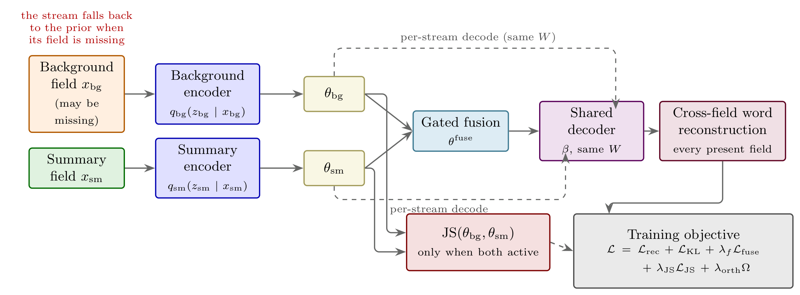
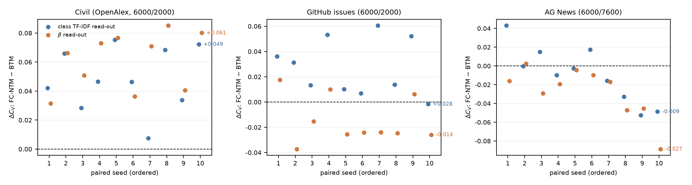
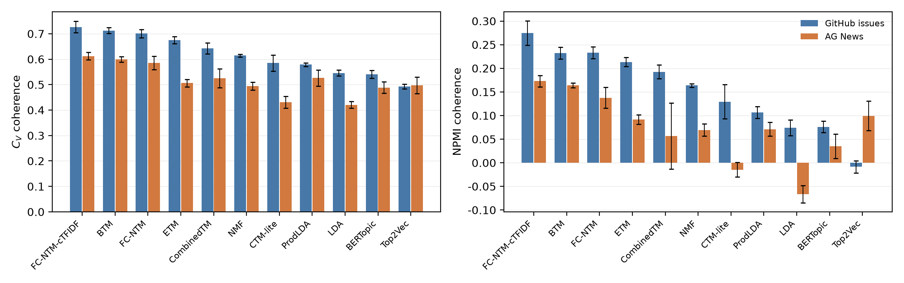
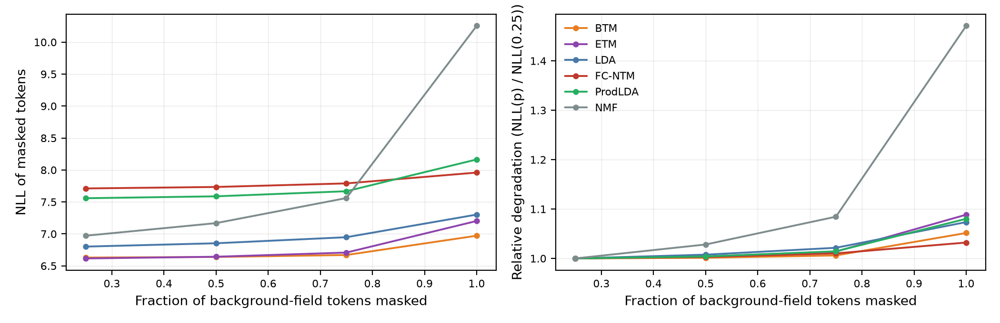

# FC-NTM: Field-Cooperative Neural Topic Modeling of Civil Engineering Literature

Reference implementation, frozen data splits and result artifacts for
*Field-Cooperative Neural Topic Modeling of Civil Engineering Literature:
Missing-Abstract Inference* (manuscript under review).

FC-NTM models the title and abstract fields of a record as two conditional
variational streams that share one linear topic decoder, with cross-field
reconstruction, a consistency term, word-level masking and whole-field
dropout. A single trained model supports a decoder read-out and a class
TF-IDF read-out under one evaluation vocabulary, and remains usable when the
abstract is missing at inference time.



## Results at a glance

Ten-seed paired comparison of FC-NTM and BTM on the civil corpus: the class
TF-IDF read-out is positive in all ten seeds, while the AG News seeds are
mixed, which is the corpus-dependent pattern the manuscript reports.



Topic quality on the two public short-text corpora under the unified
evaluation vocabulary:



Behaviour when the background field is progressively occluded:



## Repository layout

| Path | Contents |
|---|---|
| `code/` | training and evaluation entry points, corpus loaders, baselines, metrics, result CSVs under `code/outputs/`, the frozen splits under `code/data/`, regression tests and the two number checkers |
| `paper/` | LaTeX sources the number checkers parse: `main.tex` (manuscript), `main_en.tex` (analysis version), `main_asce.tex` + `main_asce.bib` (ASCE version), `supplementary*.tex`, the ASCE class files, the topic-table inputs and the figure PDFs. The submitted PDF/Word files are not distributed. |
| `docs/figures/` | rendered figures and diagrams used by this README |

Model checkpoints (11 files, 49 model states) and the large per-seed detail
dumps are published as **Release assets** of `v1.0.0` rather than in the
repository itself: `FCNTM_checkpoints_20261014.zip` and
`FCNTM_release_details_20261016.zip`.

## Reproducing the paper's numbers

```bash
cd code
python -m pip install -r requirements.txt  # CPU torch; requirements.txt
                                           # carries the PyTorch CPU index
python tests_review_fixes.py               # 33 numeric regression checks
python check_paper_numbers.py              # 764 printed numbers vs artifacts
python check_english_numbers.py --self-test  # English tables + tamper self-test
python results_manifest.py --verify        # 206-artifact manifest; reports the
                                           # Release assets (11 checkpoints + 6
                                           # detail dumps) as missing until they
                                           # are placed under outputs/
```

The checkers operate on the result CSVs that ship in `code/outputs/`. To
re-train models or re-score the released checkpoints, place the checkpoint
files from the Release assets under `code/outputs/` and
`code/outputs/rerun/`. The sentence-embedding model used by the contextual
baselines (`sentence-transformers/all-MiniLM-L6-v2`, revision pinned in
`requirements.txt`) is downloaded automatically on first use (about 90 MB)
and then cached by `huggingface_hub`; set `FCNTM_HF_OFFLINE=1` to force the
cached copy on a machine without network access.

The two number checkers read the LaTeX sources directly from `paper/`
(`main.tex` for the 764 Chinese numbers, `main_en.tex` for the English
tables) and the archived result CSVs from `code/outputs/`. No external path
is required: a fresh clone can run `python check_paper_numbers.py` and
`python check_english_numbers.py` as is. `results_manifest.py` regenerates
the manifest for the clone (`python results_manifest.py`) and reports the 17
Release assets (11 checkpoints, 6 per-seed detail dumps) as missing until
they are placed under `code/outputs/` and `code/outputs/rerun/`.

## Data

| Corpus | Source | Notes |
|---|---|---|
| Civil engineering literature | OpenAlex (CC0; subfields *Civil and Structural Engineering* and *Building and Construction*, 2000--2023) | frozen title--abstract split 6000/2000; the OpenAlex primary-topic snapshot used by the routing task is `code/outputs/civil_openalex_topics.csv`, with fetch metadata in `code/outputs/civil_openalex_topics_meta.json` |
| GitHub issues | `open-index/open-github-issues` on Hugging Face | four repositories, 6000/2000 |
| AG News | official AG News CSVs | 6000/7600 |

The splits in `code/data/` are frozen and checksum-pinned by the result
manifest. Please respect the licences of the original data sources when
redistributing or reusing them.

## Licence

The code and the archived experiment artifacts are released under the MIT
License (see `LICENSE`). The corpus splits derive from third-party sources and
remain subject to the licences of those sources.

## Citation

Citation information will be added once the paper is published.

## 中文说明

本仓库是论文投稿前的开源整理版：`code/` 为复现实验代码与结果产物，
`docs/figures/` 为渲染好的图表；论文与投稿文件不随本仓库发布，
模型检查点与逐种子明细通过 Release 附件发布。代码采用 MIT 许可证
（见 `LICENSE`）；论文录用后请补充引用信息。
