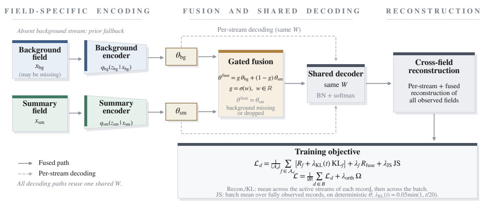
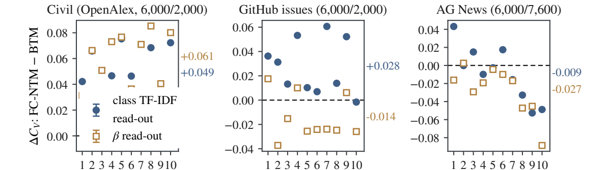
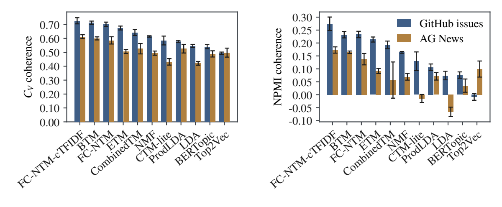
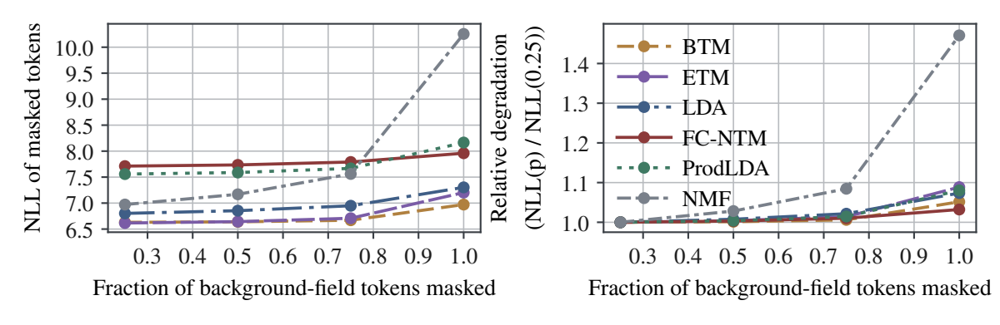

# FC-NTM: Field-Cooperative Neural Topic Modeling of Civil Engineering Literature

Reference implementation, frozen data splits and result artifacts for
*Field-Cooperative Neural Topic Modeling of Civil Engineering Literature:
Missing-Abstract Inference* (manuscript under review).

FC-NTM models the title and abstract fields of a record as two conditional
variational streams that share one linear topic decoder, with cross-field
reconstruction, a consistency term, word-level masking and whole-field
dropout. A single trained model supports a decoder read-out and a class
TF-IDF read-out under one evaluation vocabulary, and remains usable when the
abstract is missing at inference time.



## What's new (November 2026)

- The whole-field occlusion extension now covers **ten seeds for every
  baseline**: ETM, NMF and ProdLDA were re-run for seeds 53/71/89/101/113/127/139
  on all three corpora (`code/outputs/rerun/occlusion_robustness_*_etmnmfprod_seed*.csv`),
  so the cross-corpus occlusion comparison in the manuscript uses ten seeds
  for all six models.
- `docs/figures/` was refreshed with the final journal-quality versions of
  the figures (10-seed paired comparison, occlusion curves, architecture).
- The Applied Intelligence submission source and the supplementary material
  are now distributed under `paper/applied_intelligence/`.

## Results at a glance

Ten-seed paired comparison of FC-NTM and BTM on the civil corpus: the class
TF-IDF read-out is positive in all ten seeds, while the AG News seeds are
mixed, which is the corpus-dependent pattern the manuscript reports.



Topic quality on the two public short-text corpora under the unified
evaluation vocabulary:



Behaviour when the background field is progressively occluded:



## Repository layout

| Path | Contents |
|---|---|
| `code/` | training and evaluation entry points, corpus loaders, baselines, metrics, result CSVs under `code/outputs/`, the frozen splits under `code/data/`, regression tests and the two number checkers |
| `paper/` | LaTeX source of the original ASCE manuscript (`main_asce.tex`, `main_asce.bib`), the official ASCE class files and the three figure PDFs it includes. The current Applied Intelligence submission source (anonymized main manuscript `main_ApplInt.tex`, `supplementary_ApplInt.pdf` with its LaTeX source, and the eight figure PDFs) ships under `paper/applied_intelligence/`. |
| `docs/figures/` | rendered figures and diagrams used by this README |

Model checkpoints (11 files, 49 model states) and the large per-seed detail
dumps are published as **Release assets** rather than in the repository
itself: `FCNTM_checkpoints_20261014.zip` and
`FCNTM_release_details_20261016.zip` on release `v1.0.0`. The ten-seed
occlusion extension adds seven more large artifacts (the three
`fcntm_main_state_*.pt` re-runs, `civil_missing_state.pt`, and the three
`fcntm_*_seed53plus_details.json` per-seed dumps) — see release `v1.1.0`.

## Reproducing the paper's numbers

```bash
cd code
python -m pip install -r requirements.txt  # CPU torch; requirements.txt
                                           # carries the PyTorch CPU index
python tests_review_fixes.py               # numeric regression checks
python check_english_numbers.py            # tables of paper/main_asce.tex vs CSVs
python results_manifest.py --verify        # 206-artifact manifest; reports the
                                           # Release assets (11 checkpoints + 6
                                           # detail dumps) as missing until they
                                           # are placed under outputs/
```

The checkers operate on the result CSVs that ship in `code/outputs/`. To
re-train models or re-score the released checkpoints, place the checkpoint
files from the Release assets under `code/outputs/` and
`code/outputs/rerun/`. The sentence-embedding model used by the contextual
baselines (`sentence-transformers/all-MiniLM-L6-v2`, revision pinned in
`requirements.txt`) is downloaded automatically on first use (about 90 MB)
and then cached by `huggingface_hub`; set `FCNTM_HF_OFFLINE=1` to force the
cached copy on a machine without network access.

The number checkers read `paper/` directly and the archived result CSVs from
`code/outputs/`, so a fresh clone needs no external path. The Applied
Intelligence submission under `paper/applied_intelligence/` is the
double-anonymized version whose numbers were verified against the same CSVs.
Because the legacy `main_asce.tex`
ships the ASCE source only, `check_english_numbers.py` verifies the tables
that this source contains (civil-corpus quality and the ten-seed paired table)
against the per-seed CSVs and prints a skip line for the tables that are in
the supplementary PDF. `check_paper_numbers.py` (the 764-number check of the
Chinese manuscript) prints a skip message, since that source is not part of
this repository. `results_manifest.py` regenerates the manifest for the clone
(`python results_manifest.py`) and reports the 17 Release assets (11
checkpoints, 6 per-seed detail dumps) as missing until they are placed under
`code/outputs/` and `code/outputs/rerun/`.

## Data

| Corpus | Source | Notes |
|---|---|---|
| Civil engineering literature | OpenAlex (CC0; subfields *Civil and Structural Engineering* and *Building and Construction*, 2000--2023) | frozen title--abstract split 6000/2000; the OpenAlex primary-topic snapshot used by the routing task is `code/outputs/civil_openalex_topics.csv`, with fetch metadata in `code/outputs/civil_openalex_topics_meta.json` |
| GitHub issues | `open-index/open-github-issues` on Hugging Face | four repositories, 6000/2000 |
| AG News | official AG News CSVs | 6000/7600 |

The splits in `code/data/` are frozen and checksum-pinned by the result
manifest. Please respect the licences of the original data sources when
redistributing or reusing them.

## Licence

The code and the archived experiment artifacts are released under the MIT
License (see `LICENSE`). The corpus splits derive from third-party sources and
remain subject to the licences of those sources.

## Citation

Citation information will be added once the paper is published.

## 中文说明

本仓库是论文投稿前的开源整理版：`code/` 为复现实验代码与结果产物，
`docs/figures/` 为渲染好的图表；Applied Intelligence 投稿版主稿（匿名）、
补充材料及其 LaTeX 源码发布于 `paper/applied_intelligence/`，旧版 ASCE 稿源
保留在 `paper/` 根目录，模型检查点与逐种子明细通过 Release 附件发布。代码采用 MIT 许可证
（见 `LICENSE`）；论文录用后请补充引用信息。
